# Usage Monitor 任务栏主题｜Claude / Codex 额度，一眼看

把 Claude 和 Codex 的剩余额度和重置时间放进 Windows 任务栏：不挡桌面，不用点开菜单，开会共享屏幕时也看不出是什么软件，因为只用颜色区分（橙色 Claude，蓝色 Codex）。


每一行：左边是 5 小时额度（剩余百分比 / 距重置的小时数），中间是 10 格进度条（5 小时剩余，颜色由浅到深），右边是周额度（剩余百分比 / 距重置的天数，不足一天时显示小时）。

## 使用

1. 安装底层程序 [Claude Code Usage Monitor](https://github.com/CodeZeno/Claude-Code-Usage-Monitor)（MIT 协议，Windows 10/11）：

   ```
   winget install CodeZeno.ClaudeCodeUsageMonitor
   ```

2. 在程序设置里启用 Claude 和 Codex。
3. 下载本仓库里的 [`themes/F-逐段预警渐变/31-逐段淡入-十格-软件色.json`](themes/F-逐段预警渐变/31-逐段淡入-十格-软件色.json)。
4. 打开 Usage Monitor → 主题工作室 → 点主题栏右侧的"导入…" → 选择这个 JSON → 在预览里看效果 → 点"实时应用"。

## 位置偏了怎么办

主题把组件高度固定为 48 像素（Win11 任务栏标准高度），内容在里面上下居中。屏幕缩放和任务栏高度不同，会差几个像素。在主题工作室里选中 `Provider stack`，改它的 Y：数字加大，组件下移；减小，上移。调一次，之后一直有效。

`我的电脑_125缩放微调/` 里是在 125% 缩放的屏幕上多下移 2 像素的同一批文件，125% 缩放可以直接用这一份。

## 想自己改

把 [`AI提示词_定制主题.md`](AI提示词_定制主题.md) 里的提示词和你的 JSON 一起发给任何 AI，再写上想要的改动。

## 节奏线（可选）

`G-节奏线` 里的样式，在进度条上多了一根工字形的细竖线，叫节奏线。它回答一个问题：**我用额度的速度，比时间过得快还是慢？**


- 进度条显示 5 小时额度还剩多少。
- 节奏线标出这 5 小时的窗口里**时间还剩多少**：刚重置时在最右端，随时间向左走，快重置时走到最左端。
- 进度条的右端**超出**节奏线：额度剩得比时间多，节奏稳，放心用。
- 进度条的右端**落在节奏线左边**：额度花得比时间走得快，照这个速度撑不到重置，该慢一点了。
- 两者对齐：刚好匀速。

只对 5 小时额度有意义，周额度没有做。节奏线的位置按"距重置还有几小时"计算，如果程序提供的是整小时数，线会一小时跳一格。

想要节奏线又想保留原样式，每个带节奏线的样式都有对应的无节奏线版本（A–F 里的同名样式）。预览图是按文件坐标渲染的示意图，节奏线的粗细和位置以导入后的实际效果为准。

## 更多样式

只想要一个就用上面那个。下面是其他选择，导入方法相同。

| 预览（示意图） | 文件 | 特点 |
|---|---|---|
| **A-基础** | | |
| 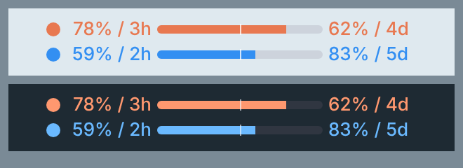 | [`01-点条-双-剩余.json`](themes/A-基础/01-点条-双-剩余.json) | 圆点区分软件；左：5 小时剩余 / 距重置，中：连续进度条（带 50% 中线），右：周剩余 / 距重置 |
| 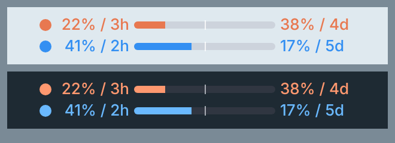 | [`02-点条-双-已用.json`](themes/A-基础/02-点条-双-已用.json) | 同上，数字改显示"已用" |
| 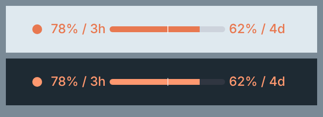 | [`03-点条-仅Claude-剩余.json`](themes/A-基础/03-点条-仅Claude-剩余.json) | 只显示 Claude 一行 |
| 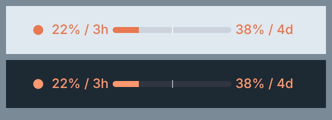 | [`04-点条-仅Claude-已用.json`](themes/A-基础/04-点条-仅Claude-已用.json) | 只显示 Claude 一行，已用 |
| 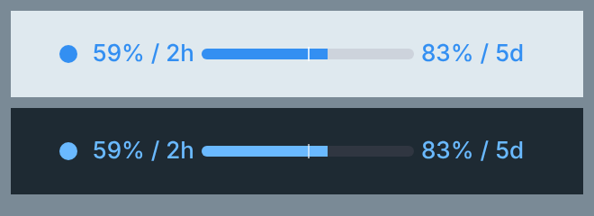 | [`05-点条-仅Codex-剩余.json`](themes/A-基础/05-点条-仅Codex-剩余.json) | 只显示 Codex 一行 |
| 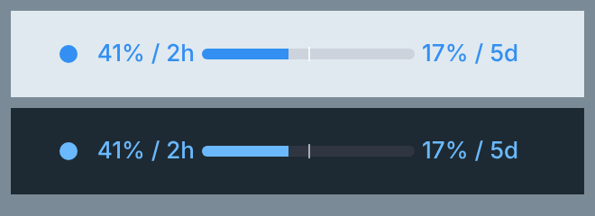 | [`06-点条-仅Codex-已用.json`](themes/A-基础/06-点条-仅Codex-已用.json) | 只显示 Codex 一行，已用 |
| **B-进度条形式** | | |
| 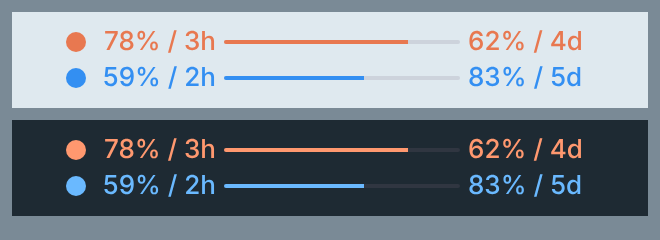 | [`07-细线.json`](themes/B-进度条形式/07-细线.json) | 2 像素细线，最低调 |
| 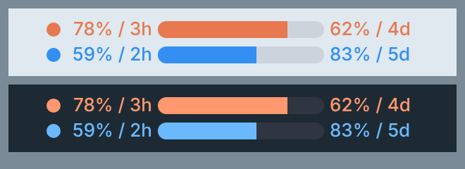 | [`08-粗条.json`](themes/B-进度条形式/08-粗条.json) | 圆角粗条，更醒目 |
|  | [`09-十格.json`](themes/B-进度条形式/09-十格.json) | 10 格分段，像电量 |
| 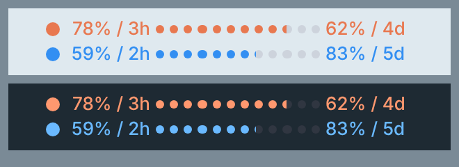 | [`10-圆点串.json`](themes/B-进度条形式/10-圆点串.json) | 12 个小点串成一条 |
|  | [`11-五段胶囊.json`](themes/B-进度条形式/11-五段胶囊.json) | 5 个胶囊 |
| 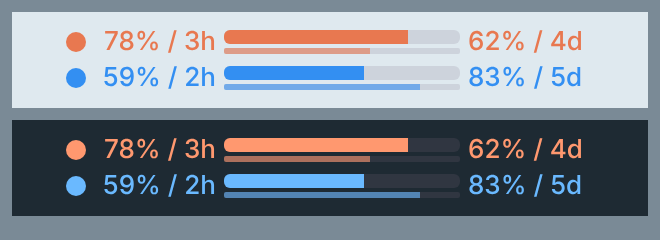 | [`12-双层条-5h加周.json`](themes/B-进度条形式/12-双层条-5h加周.json) | 上粗条 5 小时，下细条周额度，一条里看两个额度 |
| 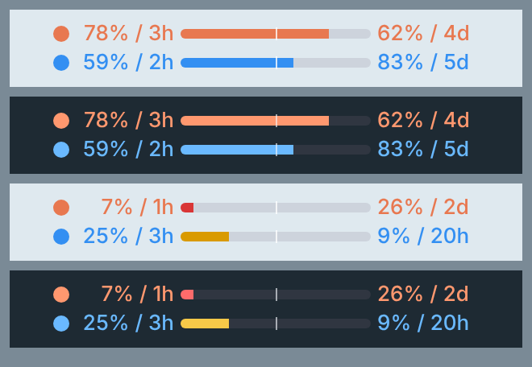 | [`13-预警变色.json`](themes/B-进度条形式/13-预警变色.json) | 整条在剩余低于 30% 变黄、低于 10% 变红 |
| 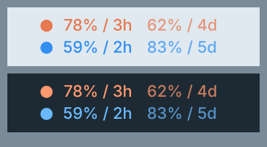 | [`14-纯文字无条.json`](themes/B-进度条形式/14-纯文字无条.json) | 没有进度条，最窄；周额度字更淡 |
| 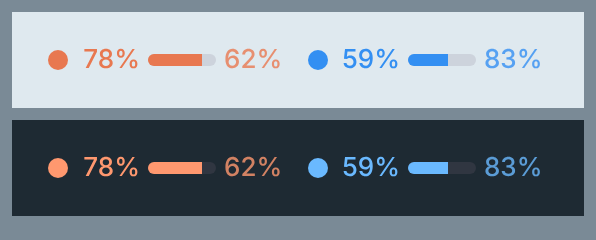 | [`15-单行并排.json`](themes/B-进度条形式/15-单行并排.json) | 两个软件并排成一行，高度只占一行 |
| **C-带标识** | | |
| 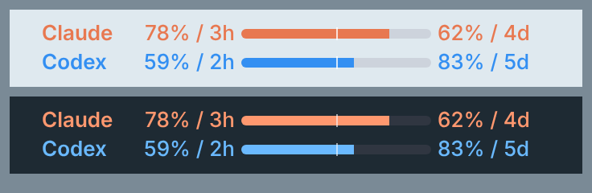 | [`16-文字标注.json`](themes/C-带标识/16-文字标注.json) | 圆点换成 Claude / Codex 文字 |
| 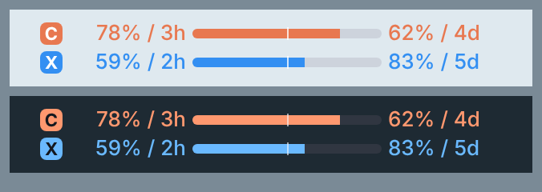 | [`17-字母徽标.json`](themes/C-带标识/17-字母徽标.json) | 圆角方块里放字母 C / X |
| 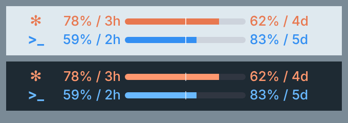 | [`18-符号标识.json`](themes/C-带标识/18-符号标识.json) | 用符号 ✻ 和 >_ 标识 |
| **D-进度条显示周额度** | | |
|  | [`19-点条-周条-剩余.json`](themes/D-进度条显示周额度/19-点条-周条-剩余.json) | 进度条改显示周额度 |
| 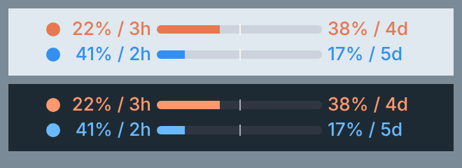 | [`20-点条-周条-已用.json`](themes/D-进度条显示周额度/20-点条-周条-已用.json) | 进度条显示周额度，已用 |
| 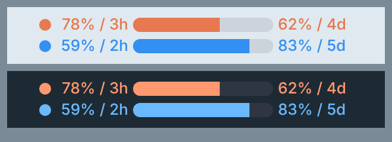 | [`21-粗条-周条-剩余.json`](themes/D-进度条显示周额度/21-粗条-周条-剩余.json) | 粗条，进度条显示周额度 |
| 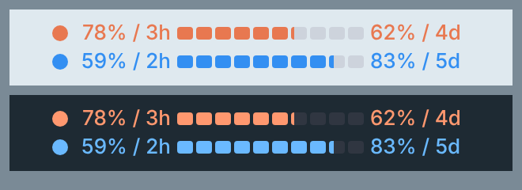 | [`22-十格-周条-剩余.json`](themes/D-进度条显示周额度/22-十格-周条-剩余.json) | 十格，进度条显示周额度 |
| 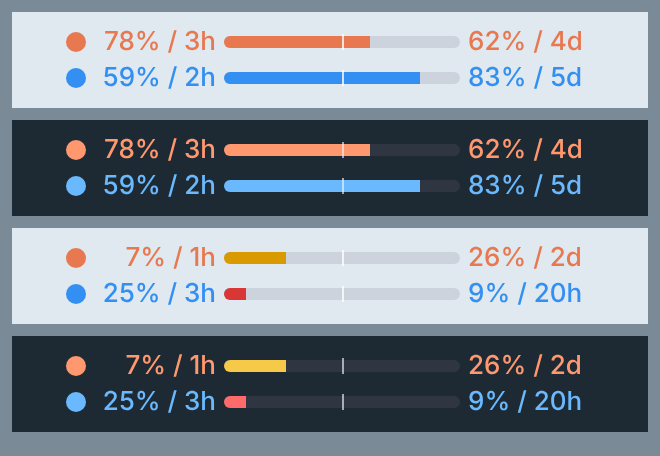 | [`23-预警变色-周条-剩余.json`](themes/D-进度条显示周额度/23-预警变色-周条-剩余.json) | 整条预警变色，按周额度 |
| **F-逐段预警渐变** | | |
| 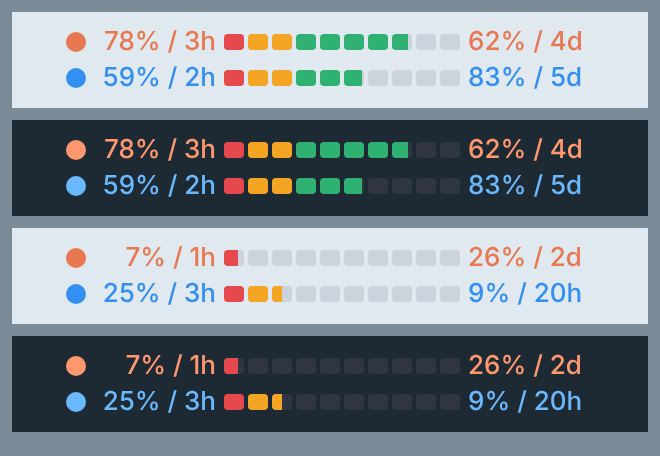 | [`26-逐段预警-十格.json`](themes/F-逐段预警渐变/26-逐段预警-十格.json) | 10 格，每格固定一个颜色：最后 1 格红，接下来 2 格黄，其余绿。剩余越少，只剩红黄格 |
| 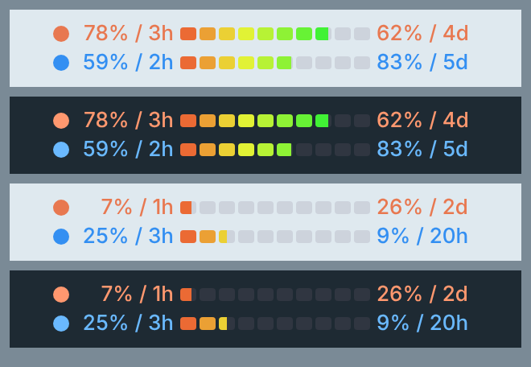 | [`27-逐段渐变-十格.json`](themes/F-逐段预警渐变/27-逐段渐变-十格.json) | 10 格，每格颜色从红渐变到橙黄再到绿 |
| 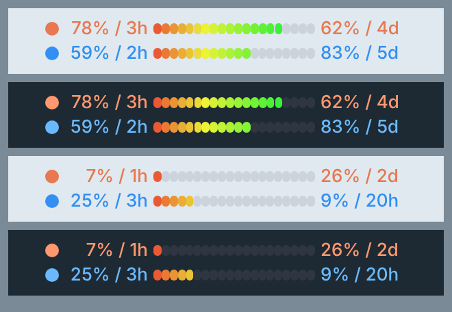 | [`28-连续渐变条-二十段.json`](themes/F-逐段预警渐变/28-连续渐变条-二十段.json) | 20 个紧挨的小段，看起来是一条红到绿的连续渐变条 |
| 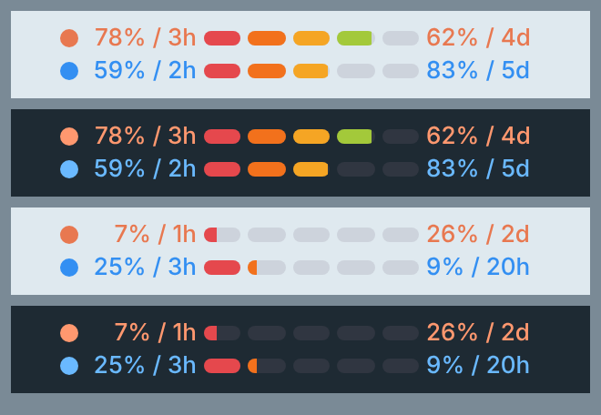 | [`29-逐段预警-五胶囊.json`](themes/F-逐段预警渐变/29-逐段预警-五胶囊.json) | 5 个胶囊，红、橙、黄、黄绿、绿 |
| 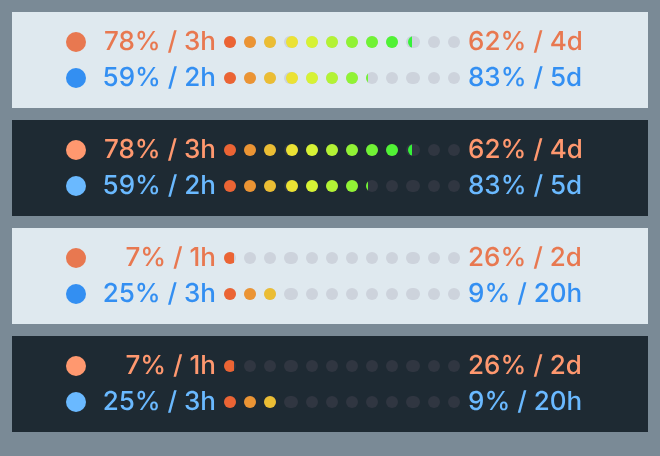 | [`30-逐段渐变-圆点串.json`](themes/F-逐段预警渐变/30-逐段渐变-圆点串.json) | 12 个圆点，红到绿渐变 |
| 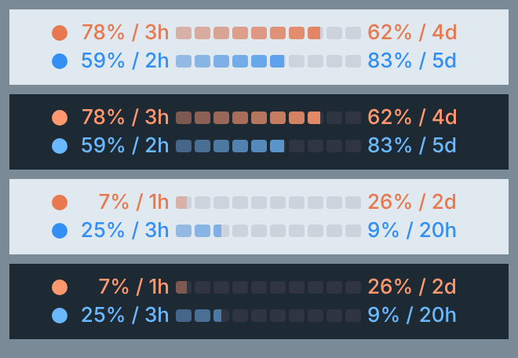 | [`31-逐段淡入-十格-软件色.json`](themes/F-逐段预警渐变/31-逐段淡入-十格-软件色.json) | 10 格，用各自软件的颜色由浅到深（推荐） |
| 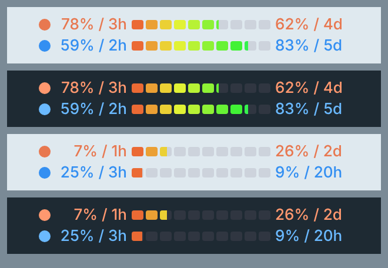 | [`32-逐段渐变-十格-周条.json`](themes/F-逐段预警渐变/32-逐段渐变-十格-周条.json) | 同 27，进度条显示周额度 |
| **G-节奏线** | | |
| 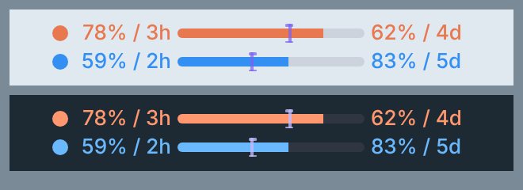 | [`33-节奏线-连续条.json`](themes/G-节奏线/33-节奏线-连续条.json) | 连续进度条 + 节奏线（工字形竖线），看"额度剩得快还是时间走得快"，说明见上 |
| 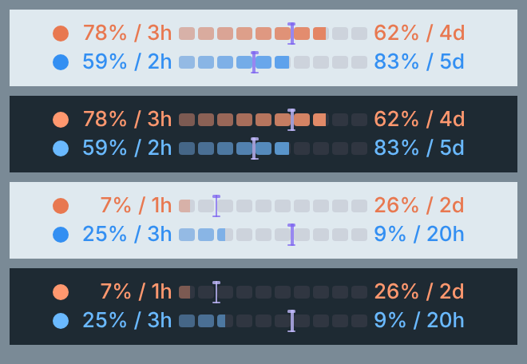 | [`34-节奏线-逐段淡入十格.json`](themes/G-节奏线/34-节奏线-逐段淡入十格.json) | 31 推荐样式 + 节奏线 |
| 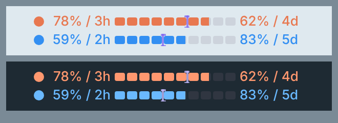 | [`35-节奏线-十格.json`](themes/G-节奏线/35-节奏线-十格.json) | 09 十格 + 节奏线 |
| 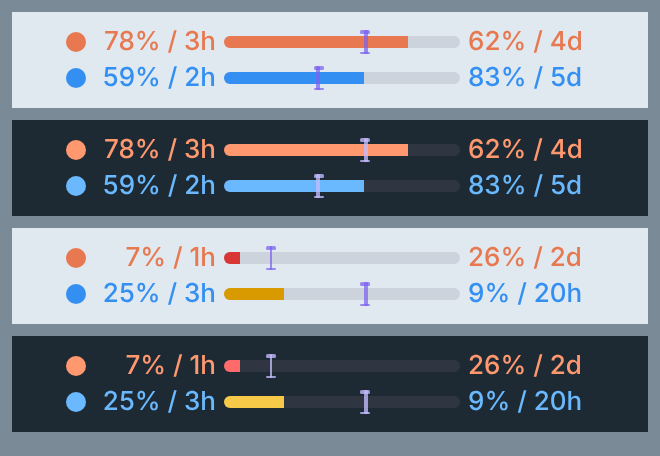 | [`36-节奏线-预警变色.json`](themes/G-节奏线/36-节奏线-预警变色.json) | 13 预警变色 + 节奏线（去掉了 50% 中线） |
|  | [`37-节奏线-逐段预警十格.json`](themes/G-节奏线/37-节奏线-逐段预警十格.json) | 26 逐段预警十格 + 节奏线 |

## 说明

- 本仓库只含主题文件，不含底层程序，底层程序归 CodeZeno/Claude-Code-Usage-Monitor。
- 推荐样式（31）作者实测可用；表格里的预览图是按主题文件坐标渲染的示意图，不是程序截图，字体和实际略有差别。其余样式导入后请在预览里确认效果。
- 逐段渐变系列每一格是独立元素，元素较多，文件比较大。
- 欢迎提交真实截图和自己的样式。
- 许可证：[MIT](LICENSE)。
